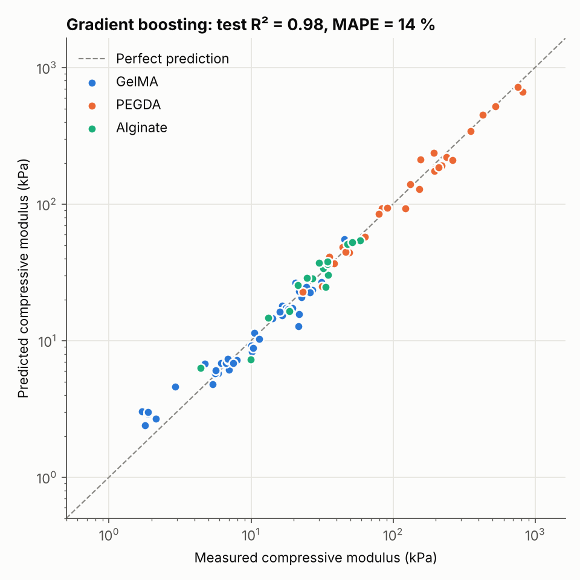
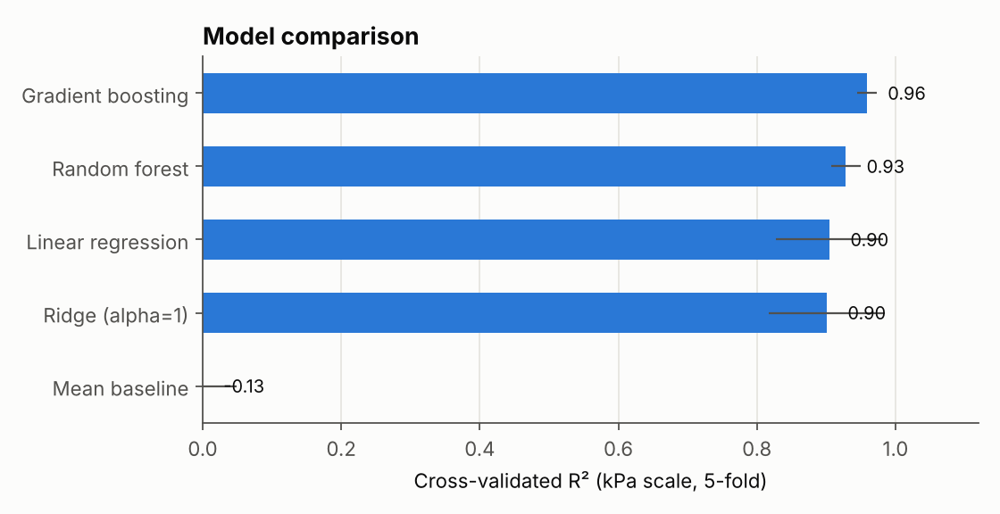
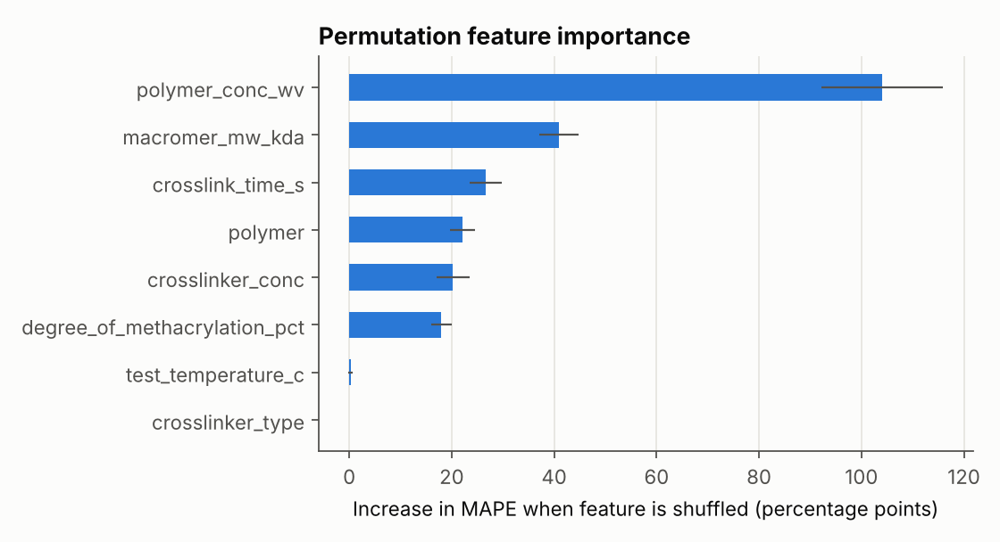

# Biomaterial Mechanical Property Predictor

**Machine-learning prediction of hydrogel stiffness from formulation and processing parameters**

*Author: Anje Heine. MSc Tissue Engineering and Biomaterials (UCL), MEng Materials Science and Engineering with Biomaterials (Imperial College London)*

---

## Why I built this

Hydrogel stiffness matters in tissue engineering. Substrate modulus affects stem-cell
differentiation, cell spreading and the immune response to an implant. Tuning it usually
takes a lot of trial and error: make a formulation, crosslink it, run compression testing,
repeat.

I built this project **retrospectively**, after my undergraduate lab work at Imperial College
London. That work included a project tuning Sylgard PDMS formulations to a target Young's
modulus for soft-tissue analogues, and a rheology study of eight crosslinked PVA gel
formulations. In both, finding the right formulation meant trial and error in the lab.
Looking back, I wanted a reusable computational workflow that could learn
formulation–property relationships from measurements and narrow the design space before
going into the lab, to support similar work in my future research.

The model takes a formulation (polymer, concentration, crosslinker dose, crosslinking time
and so on) and predicts its compressive modulus. That makes it possible to screen candidate
formulations against a target stiffness, such as soft brain-like (~1 kPa), muscle-like
(~10 kPa) or pre-osteoid (~30+ kPa) matrices.

> **Note:** the code was written after those projects, not during them. The results below
> come from a synthetic dataset (see "About the data" below), not from my lab
> measurements.

## What it does

- **Reproducible data pipeline**: loads a formulation table, validates the columns and handles
  polymer-specific parameters that only apply to some materials.
- **Domain-informed feature engineering**: log-transformed concentration, crosslinker and time
  features, so the models can capture the power-law scaling *E ∝ cⁿ* predicted by
  polymer-network theory.
- **Log-scale target**: stiffness spans three orders of magnitude and measurement error is
  roughly multiplicative, so the models learn log₁₀(E).
- **Model comparison** with 5-fold cross-validation: mean baseline, linear regression, ridge,
  random forest and gradient boosting.
- **Held-out evaluation**: R², MAE, RMSE and MAPE, reported overall and per polymer.
- **Interpretability**: permutation feature importance shows which formulation parameters
  drive stiffness.
- **Prediction CLI** for new formulations, either one at a time or as a batch from a CSV.
- **Unit tests** (pytest) covering data integrity, physical trends and model performance.

## Results (on the included dataset)

| Model | CV R² (5-fold) | CV MAPE |
|---|---|---|
| Mean baseline | −0.13 | 142 % |
| Linear regression | 0.91 ± 0.08 | 16.8 % |
| Ridge | 0.90 ± 0.08 | 16.8 % |
| Random forest | 0.93 ± 0.02 | 22.7 % |
| **Gradient boosting** | **0.96 ± 0.01** | **16.0 %** |

On the held-out test set (n = 90), gradient boosting reached **R² = 0.98** with a
**mean absolute percentage error of 14 %**. That is close to the ~12 % measurement noise
built into the data, so the model is near the best achievable on this dataset.

<p align="center"></p>

| Model comparison | Feature importance |
|---|---|
|  |  |

**Interpretation.** Polymer concentration has by far the largest effect on stiffness,
followed by PEGDA macromer molecular weight (longer chains between crosslinks give a softer
network) and crosslinking time. This matches what network theory and the hydrogel literature
predict. A plain linear model already performs well once log features are added, which shows
the value of physically motivated feature engineering. The tree ensembles add gains by
capturing saturation of crosslinking.

## ⚠️ About the data

Open datasets that pair hydrogel formulations with measured stiffness are scarce and usually
spread across tables in individual papers. To develop and test the pipeline end to end,
`data/hydrogel_formulations.csv` is a **synthetic dataset** (450 samples) produced by
`data/generate_dataset.py`.

**How it was made:** random formulations are generated, and a stiffness is calculated for
each from simple formulas plus random noise. The *shape* of the formulas follows established
qualitative trends. The numerical coefficients were **chosen by hand** to give plausible
stiffness ranges; they were **not fitted to any published dataset**. The model's high scores
therefore show that the pipeline works correctly. They say nothing about real materials.

Trends encoded:

- power-law concentration scaling (E ∝ c^2–2.5)
- saturating dependence on photoinitiator dose and UV exposure (or CaCl₂ and gelation time for alginate)
- lower modulus at higher PEGDA molecular weight
- higher modulus at higher GelMA degree of methacrylation
- ~12 % multiplicative experimental noise

The generated values span roughly 2–55 kPa for GelMA, 6–800 kPa for PEGDA and 4–75 kPa for
Ca-alginate. These figures are **not real measurements** and should not be used to design
materials. The pipeline is built so that **real lab data drops straight in** (see below).
Applying it to measured data, such as my PDMS formulation results or published open-access
GelMA compression data, is the planned next step.

## Using your own experimental data

Replace or add a CSV with these columns (leave a cell blank where a parameter doesn't apply):

| Column | Description |
|---|---|
| `polymer` | e.g. `GelMA`, `PEGDA`, `Alginate` |
| `polymer_conc_wv` | polymer concentration, % w/v |
| `macromer_mw_kda` | macromer molecular weight, kDa (PEGDA) |
| `degree_of_methacrylation_pct` | degree of methacrylation, % (GelMA) |
| `crosslinker_conc` | LAP % w/v, or CaCl₂ mM |
| `crosslinker_type` | `LAP_wv` or `CaCl2_mM` |
| `crosslink_time_s` | UV exposure or gelation time, s |
| `test_temperature_c` | mechanical-testing temperature, °C |
| `compressive_modulus_kpa` | **target**: measured compressive modulus, kPa |

Then run `python src/train.py --data path/to/your_data.csv`.

## Quick start

```bash
git clone https://github.com/anjeheine04/hydrogel-stiffness-predictor.git
cd hydrogel-stiffness-predictor
pip install -r requirements.txt

# (optional) regenerate the synthetic dataset
python data/generate_dataset.py --n 450 --seed 42

# train, compare and evaluate models; writes figures to results/ and the model to models/
python src/train.py

# predict new formulations
python src/predict.py --input data/example_new_formulations.csv --output results/new_predictions.csv
python src/predict.py --polymer GelMA --conc 10 --dom 80 --crosslinker 0.25 --time 60 --temp 37

# run tests
python -m pytest -q
```

## Project structure

```
hydrogel-stiffness-predictor/
├── data/
│   ├── generate_dataset.py          # literature-informed synthetic data generator
│   ├── hydrogel_formulations.csv    # 450-sample dataset (synthetic)
│   └── example_new_formulations.csv # formulations to predict
├── src/
│   ├── features.py                  # feature definitions, physics-based features, preprocessing
│   ├── train.py                     # CV model comparison, evaluation, figures, model export
│   ├── predict.py                   # CLI for predicting new formulations
│   └── plotting.py                  # colour-blind-safe figure styling
├── models/stiffness_model.joblib    # trained model
├── results/                         # metrics.json, CSVs and figures
├── tests/test_pipeline.py
└── requirements.txt
```

## Skills demonstrated

Python · pandas · NumPy · scikit-learn (pipelines, ColumnTransformer, cross-validation,
ensemble regression, permutation importance) · regression and model evaluation · feature
engineering grounded in polymer physics · Matplotlib · reproducible research software · pytest

## Limitations and next steps

- Validate on real data: my own PDMS formulation measurements, and published open-access
  formulation studies (e.g. GelMA compression-modulus datasets).
- Add uncertainty estimates (quantile gradient boosting or Gaussian-process regression) so each
  prediction comes with a confidence interval.
- Inverse design: search formulation space for the cheapest recipe that hits a target modulus.
- Extend to other properties: swelling ratio, degradation rate, storage modulus (rheology).

## License

MIT. See [LICENSE](LICENSE).
